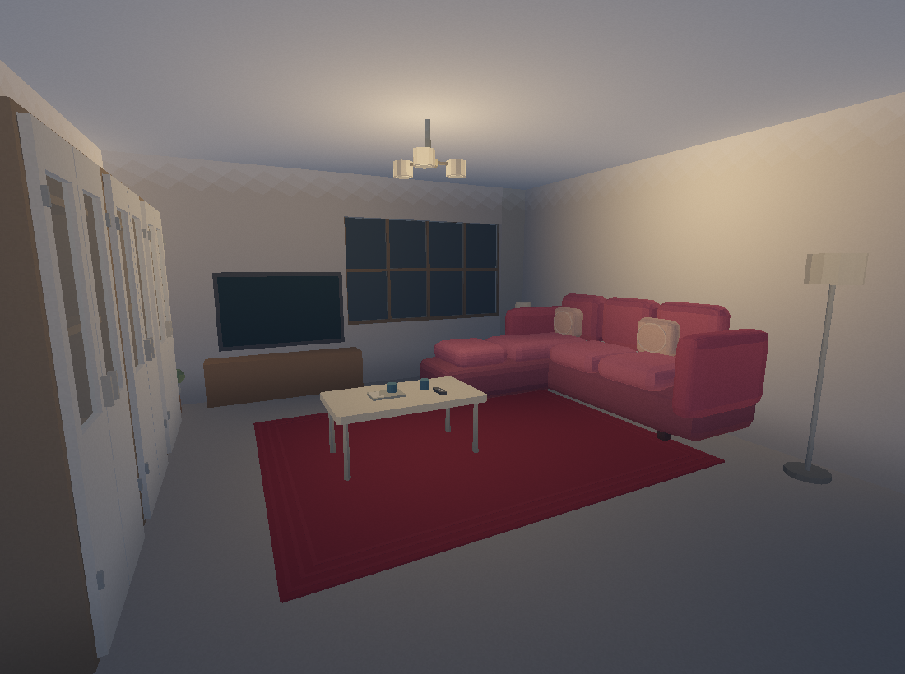
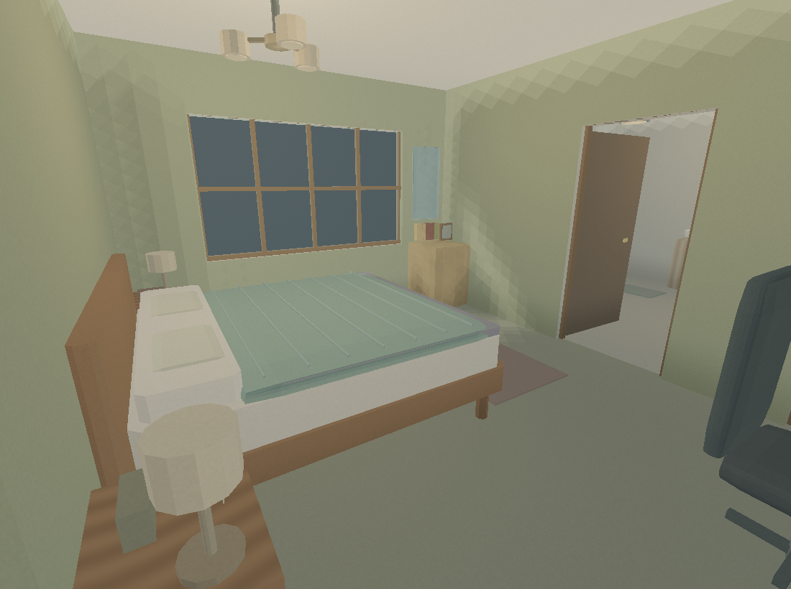
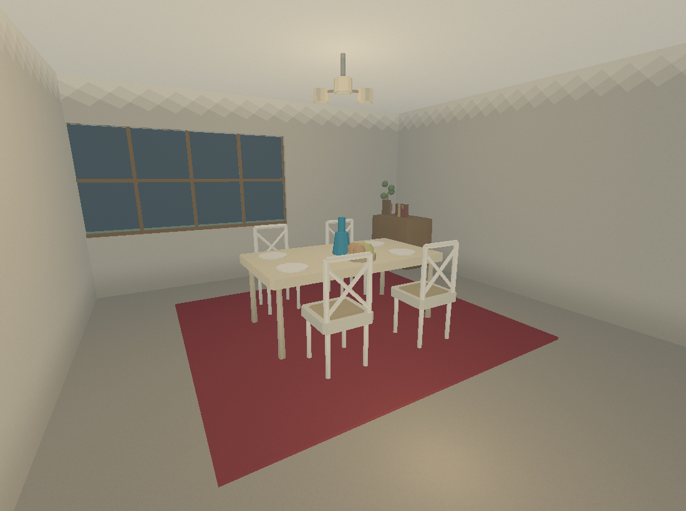
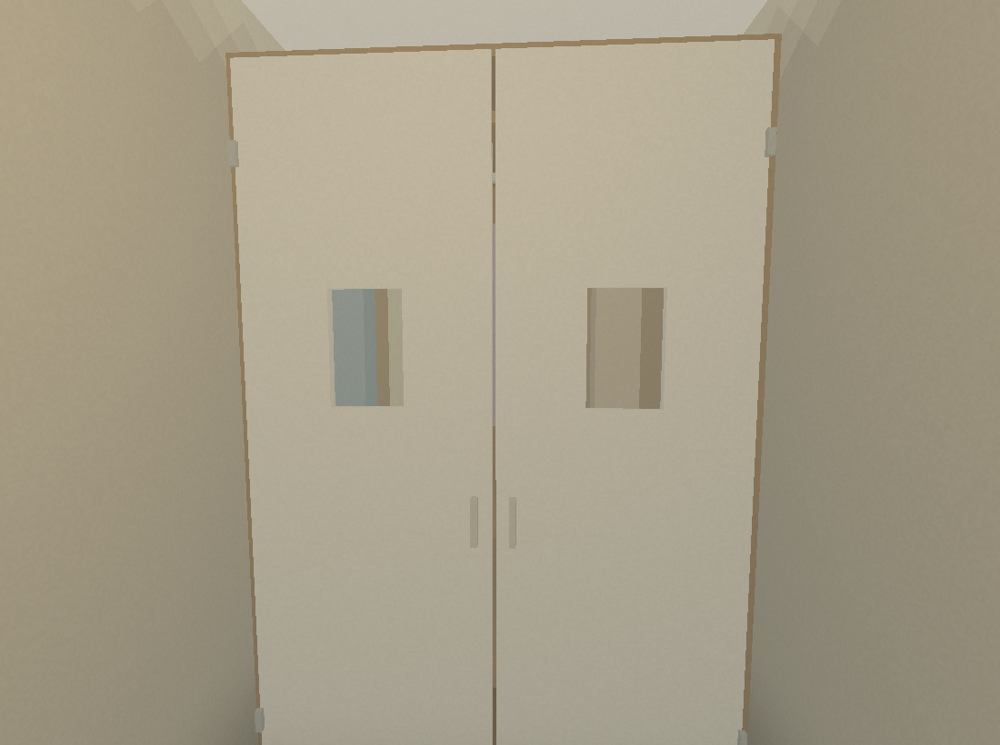

# Tanglewood · FORMA Studio v3.1

Автономний редактор із вбудованою реконструкцією Tanglewood Legacy.

- [Завантажити редактор](index.html): скачайте HTML та відкрийте локально у сучасному браузері.
- [Повний проєкт ZIP](Tanglewood_FORMA_Project.zip): редактор, model.json, scene.js, список текстурних слотів, інструкція та приклад lathe.

## Можливості

Інструменти FORMA v3.1: lathe, extrude2D, parametric, пакетні JS-композиції,
мультивиділення, редагування вершин і полігонів, UV та бібліотека текстур.
WebGL-перегляд підтримує атлас текстур, повторення UV, огляд кімнат і прогулянку.
JSON та JS зберігають планування, зв’язки освітлення й маркери карти.

Виберіть кімнату та натисніть «Зайти в кімнату». WASD / стрілки — рух,
перетягування сцени — огляд, Esc — редактор. Є кнопки руху для телефона.

## Текстури

Підготовлено 20 слотів із шляхами `~/textures/...`. Зображення користувача
ще не додані; до їх завантаження видно базові кольори матеріалів.
Назви, масштаб повторення та інструкції містяться всередині ZIP.

## Перевірено

57 822 вершин, 39 966 полігонів; UV на кожній грані. Перевірені формат v3,
мультивиділення, копіювання/відміна, експорт та імпорт JS із метаданими.
Шейдери скомпільовані через OpenGL ES; семплювання текстур і повторення UV
перевірені діагностичною відрисовкою. Повний інтерактивний браузерний тест
ще не проведений. Прогулянка перевіряє стіни, але не фізику меблів.

Масштаб і меблювання — реконструкція за планом та візуальними референсами.

## Окремі предмети та прототип рук

444 груп разом з архітектурою. Вибір у сцені й у списку охоплює всі
деталі предмета. Диван, ліжка, стільці та автомобіль зібрані; чашки, тарілки,
корзини й три вітрини розділені. UV та шляхи текстур збережені.

- [objects.json](objects.json): стабільні ID, групи, межі, pivot і дозвіл взяття.
- У ZIP: `pickup-templates.json`, 135 окремих мешів у локальних координатах.
- [pickup-runtime.js](pickup-runtime.js): адаптер для кріплення до `right_hand` у грі.

У редакторі виберіть дрібний предмет та натисніть «Примерить выбранное в руках».
У прогулянці: **E** — взяти найближче в межах 1,8 м, **G** — повернути на місце.
Предмет тимчасово приховується у світі та показується внизу праворуч.
Це макет без фізики, кидка та анімації кистей; збереження не змінює вихідні позиції.
JSON і JS зберігають реєстр предметів та параметри рук.

За скриншотом користувача видалено окремий короб «Шкаф коридора 02» посеред коридору: стіни, двері, ручку та відповідні колізії.

## Вимикачі

Усі 14 вимикачів розвернуті лицем у кімнату та закріплені на суцільних
стінах біля входів. На вузьких простінках використана сусідня стіна.
Висота — 1,25 м від місцевої підлоги, зазор рамки — 1 мм. Вимикач підвалу
перенесений униз до сходів. Координати, нормалі та кріплення збережені
у `lightingNetwork` і `objects.json`; електрична логіка гри ще вимкнена.

## Обстановка кімнат

Меблі біля стін вирівняні; центральні столи залишені на місці. Додано 136 окремих груп: книги, іграшки, одяг, рослини, посуд, побутові речі та інвентар у гаражі й підвалі. Нові переносні предмети включені в прототип рук. Перевірені дверні прорізи та доступ до вимикачів.

Діагностичні рендери поточної геометрії без завантажених текстур:

## Розстановка v2

Ліжка узголів’ями до стін, столи з ПК задньою стороною до стін: зазор 15 мм. Обидва ряди стільців звернені до обіднього столу й підсунуті до нього. Додані 4 лампи на тумбах, килими в дитячу й коридор та триплечі люстри у спальню, вітальню й їдальню.

## Двостулкові шафи зі склом

Гардероб, три вітрини, гаражні локери й вбудована шафа коридору мають по дві стулки. Корпуси порожнисті, за склом видно полиці та речі. Скло — окремий прозорий полігон у справжньому отворі рамки.

Панель «Шафи · дверцята» відкриває та закриває обрану шафу; Undo скасовує зміну. JSON/JS зберігають поточні кути й геометрію. [cabinet-doors.json](cabinet-doors.json) містить шарніри, кути та групи для інтеграції у гру. Ігрова взаємодія ще не підключена.

